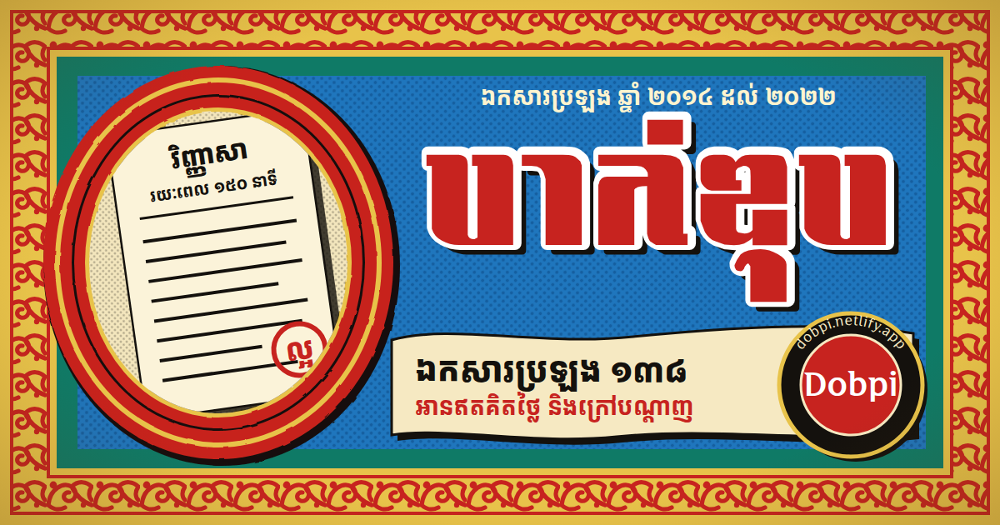

# Bacii — ឯកសារប្រឡងបាក់ឌុប



---

<div align="center">

## 🇰🇭 Stand with Cambodia • កម្ពុជា

### 🕊️ **Cambodia Needs Peace** 🕊️

We stand in solidarity with our brave soldiers defending Cambodia's sovereignty and territorial integrity. Our hearts are with those protecting our homeland during these challenging times. We call upon the international community to support peaceful resolution and respect for Cambodia's borders.

**🙏 កម្ពុជាត្រូវការសន្តិភាព • Together we stand for peace and sovereignty**

</div>

---

**Bacii (Dobpi)** is a free, easy-to-use viewer for Cambodian national exam papers (ឯកសារប្រឡងបាក់ឌុប). It helps students browse, read, and study past exam papers — anytime, on any device, even offline.

🌐 **Live Site**: [https://dobpi.netlify.app](https://dobpi.netlify.app)
📱 **Android App**: [Download APK](https://github.com/HELMAB/bacii/releases/download/1.0.1/bacii-app.apk)

> **A note on the documents** — All exam papers and documents belong to their respective owners. This site was built **only to help Cambodian students find study materials easily**, with full credit and respect to the original owners.

## Features

### 📖 Reading exam papers

- Pages fit your screen automatically, on phones, tablets, and desktops
- Zoom in and out (50% – 200%) without losing your place
- Fullscreen mode for distraction-free study
- Download or print any paper
- Page counter while you scroll
- Jump through internal document links
- Quick scroll-to-top button
- Clear loading progress, and a retry button if a paper can't be opened

### 🔀 Compare two papers

- View two exam papers side by side
- Pick any document for each side
- Swap the two papers with one tap
- Zoom each paper on its own
- Great for comparing subjects or different years

### 🧭 Finding documents

- Organized by category, year, and subject
- Search across every subject instantly
- Move to the previous/next paper with the arrow keys
- Current document title, year, and position always shown
- Every paper has its own link you can bookmark or share
- The app reopens at the paper and page where you stopped
- The Back button moves between papers and closes open panels

### 📲 Works offline (installable app)

- Install it on your phone or computer like a normal app
- Papers you've opened stay available without internet
- Download every paper for offline reading (about 250 MB), with the size shown first and the option to cancel
- Connection status indicator when you go offline
- Fast loading thanks to smart caching

### 🎨 Comfortable to use

- Clean, minimal design that keeps the focus on the documents
- Light and dark mode, with your choice remembered
- Collapsible sidebar
- Responsive layout for mobile, tablet, and desktop
- Helpful toast messages and smooth transitions

### ♿ Built for Khmer students

- Full Khmer language interface (km-KH)
- Authentic Khmer typography with the PengHuoth font
- Keyboard shortcuts and large, touch-friendly controls

## Keyboard shortcuts

| Key   | Action               |
| ----- | -------------------- |
| `/`   | Focus the search box |
| `←`   | Previous document    |
| `→`   | Next document        |
| `+`   | Zoom in              |
| `-`   | Zoom out             |
| `F`   | Toggle fullscreen    |
| `ESC` | Close sidebar        |

## Available exam papers

### ថ្នាក់វិទ្យាសាស្ត្រសង្គម (Social Sciences)

អក្សរសាស្ត្រខ្មែរ • គណិតវិទ្យា • រូបវិទ្យា • ជីវវិទ្យា • ប្រវត្តិសាស្ត្រ • ភូមិវិទ្យា • ផែនដីវិទ្យា • សីលធម៌-ពលរដ្ឋ • ភាសាអង់គ្លេស • ភាសាបារាំង

### ថ្នាក់វិទ្យាសាស្ត្រពិត (Natural Sciences)

អក្សរសាស្ត្រខ្មែរ • គណិតវិទ្យា • រូបវិទ្យា • គីមីវិទ្យា • ជីវវិទ្យា • ប្រវត្តិសាស្ត្រ • ភាសាអង់គ្លេស • ភាសាបារាំង

138 papers from 2014 to 2022 across both streams, including both 2014 exam sessions.

## Install on your device

**Desktop (Chrome / Edge)**

1. Visit [https://dobpi.netlify.app](https://dobpi.netlify.app)
2. Click the install icon in the address bar
3. Confirm to install — it opens in its own window

**Android**

1. Open the site in Chrome or Firefox
2. Tap the menu (⋮) → "Install app" / "Add to Home Screen"
3. Or download the [native Android APK](https://github.com/HELMAB/bacii/releases/download/1.0.1/bacii-app.apk)

**iPhone / iPad (Safari)**

1. Open the site in Safari
2. Tap the Share button
3. Choose "Add to Home Screen"

## Development

Requires Node 22 (see `.nvmrc`).

```bash
npm install
npm run dev        # Dev server at http://localhost:3000
npm run build      # Production build in .output/public
npm run preview    # Serve the build locally (needed to test the Service Worker)
npm run lint       # ESLint
```

**Add an exam paper**

1. Put the PDF at `public/pdfs/{category}/{year}/{subject}.pdf`
2. Add an entry for it to `public/docs.json`, which sets the sidebar and navigation order
3. For a new subject, add its icon to `app/constants/icons.js`

**Update the banner**: edit `public/og-image.svg`, then run `npm run generate-png-assets`. This requires Google Chrome, plus the Niradei font for the Khmer text.

## License

MIT License — see the [LICENSE](LICENSE) file for details.
